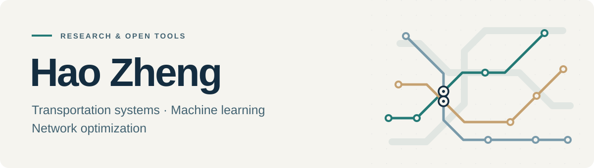
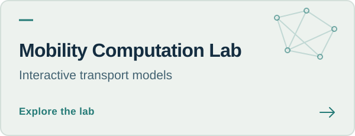

  

  <a href="https://scholarhaozheng.github.io/"><strong>Academic website</strong></a>
  &nbsp; · &nbsp;
  <a href="https://scholar.google.com/citations?user=5XSrtxwAAAAJ">Google Scholar</a>
  &nbsp; · &nbsp;
  <a href="https://orcid.org/0009-0004-8845-5137">ORCID</a>
  &nbsp; · &nbsp;
  <a href="mailto:scholarhaozheng@gmail.com">Email</a>

I study **transportation systems through optimization, machine learning, and network modeling**. My work connects mobility data and transportation knowledge with computational methods for prediction and decision-making.

I received my **M.S. in Transportation Engineering from Tsinghua University (2025)** and work as a **Research Assistant at Beijing Jiaotong University**.

### Featured work

  
  

**[KNOWCAST](https://github.com/scholarhaozheng/KNOWCAST)** integrates transportation knowledge into deep learning for metro origin–destination forecasting and path-flow estimation. The repository brings together the published paper, figures, and a structured pseudocode companion.

[Project website](https://scholarhaozheng.github.io/KNOWCAST/) · [Paper · Transportation Research Part C, 2026](https://doi.org/10.1016/j.trc.2026.105710) · [Pseudocode guide](https://github.com/scholarhaozheng/KNOWCAST/blob/main/PSEUDOCODE_GUIDE.md)

**[Mobility Computation Lab](https://github.com/scholarhaozheng/mobility-network-lab)** connects city networks, travel demand, and network computation through documented case studies, GMNS workflows, and traffic-assignment experiments. Developed under the guidance of Prof. Xuesong Zhou.

[Explore the lab](https://scholarhaozheng.github.io/mobility-network-lab/) · [Interactive assignment demo](https://scholarhaozheng.github.io/mobility-network-lab/traffic-assignment-lab.html) · [Experiment catalog](https://scholarhaozheng.github.io/mobility-network-lab/reproduce.html)

### Research interests

- **Knowledge-guided forecasting** — metro demand, graph learning, and path-flow inference.
- **Network optimization** — traffic assignment, space–time networks, and decomposition methods.
- **Mobility decision support** — urban transport, multimodal logistics, and infrastructure management.

---

For publications, experience, and the broader research portfolio, visit my **[academic website](https://scholarhaozheng.github.io/)**.
