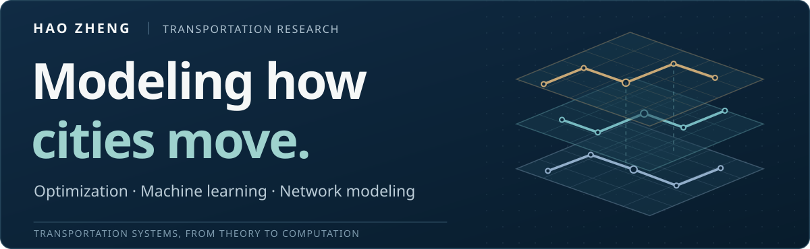
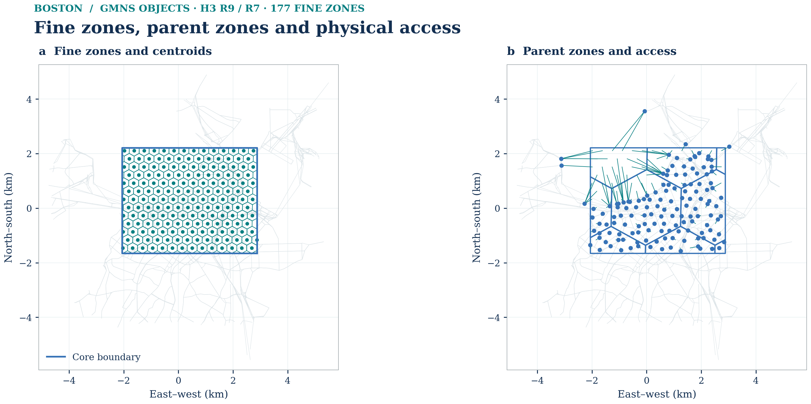
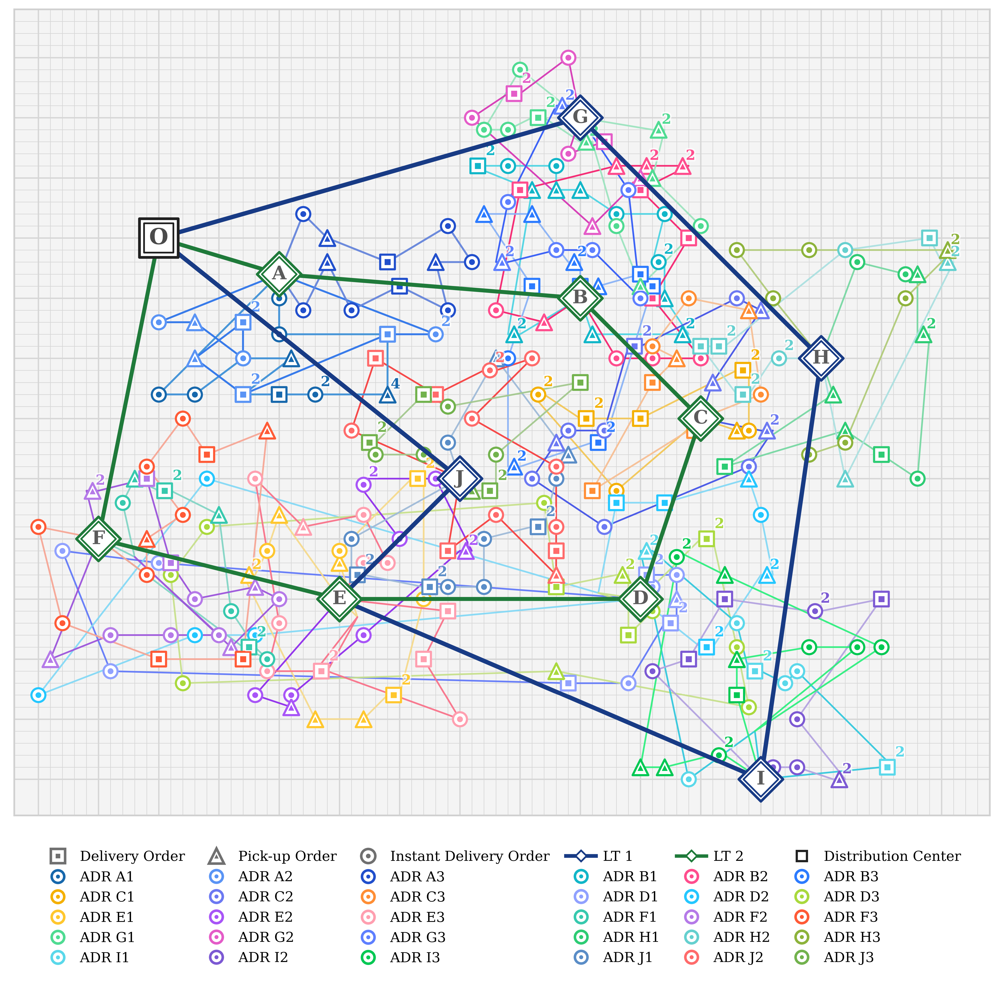

<a href="https://scholarhaozheng.github.io/">
  <picture>
    <source media="(max-width: 640px)" srcset="assets/v2/hero-mobile.svg">
    
  </picture>
</a>

 &nbsp; &nbsp;  &nbsp; &nbsp;  &nbsp; &nbsp;  &nbsp; &nbsp; 

I develop computational methods for **transportation systems**, connecting mobility data, transportation knowledge, and network optimization to support prediction and decision-making.

M.S. in Transportation Engineering, **Tsinghua University** · Research Assistant, **Beijing Jiaotong University**.

## Selected work

<table width="100%">
<tr><td>

01 / KNOWLEDGE-INTEGRATED LEARNING

<h3>KNOWCAST</h3>

Transportation Research Part C · 2026

<strong>Metro OD forecasting and path-flow estimation.</strong> Transportation knowledge shapes the features, training objective, and model architecture. Explore the paper and its structured pseudocode companion.

 &nbsp; &nbsp;  &nbsp; &nbsp;  &nbsp; &nbsp; 

</td></tr>
</table>

<table width="100%">
<tr><td>

02 / NETWORK COMPUTATION

<h3>Mobility Computation Lab</h3>

Boston case · Fine zones, parent zones &amp; physical access

<strong>From city data to network computation.</strong> Documented city cases, GMNS workflows, and traffic-assignment experiments. Developed under the guidance of <strong>Prof. Xuesong Zhou</strong>.

 &nbsp; &nbsp;  &nbsp; &nbsp;  &nbsp; &nbsp; 

</td></tr>
</table>

<table width="100%">
<tr><td>

03 / URBAN LOGISTICS

<h3>Truck–robot logistics</h3>

Transportation Research Record · Accepted

<strong>Integrated routing of trucks and robots.</strong> Space–time networks and branch-and-price for urban express logistics.

 &nbsp; &nbsp; 

</td></tr>
</table>

## More research

<strong><a href="https://doi.org/10.1080/10298436.2026.2708283">Pavement maintenance scheduling</a></strong> Connecting maintenance task generation with vehicle-route optimization. International Journal of Pavement Engineering · 2026

 &nbsp; &nbsp; 

<strong><a href="https://doi.org/10.3390/info12100429">Customized shuttle transit</a></strong> Route planning for demand that varies across space and time. Information · 2021

 &nbsp; &nbsp; 

---

 &nbsp; &nbsp; 

