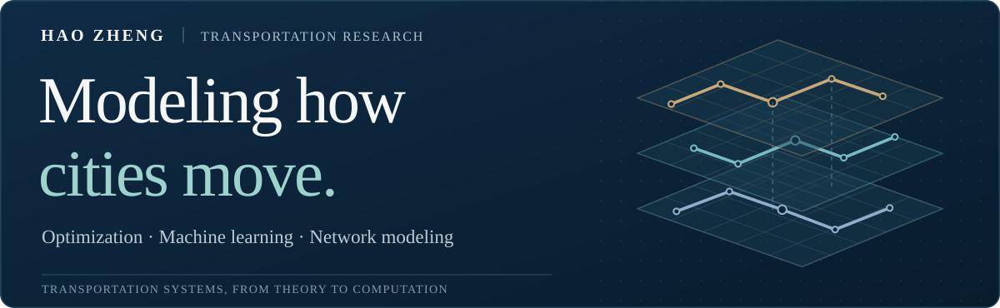
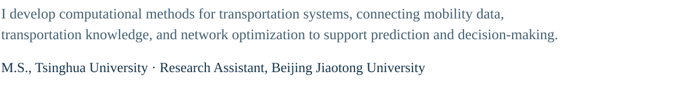
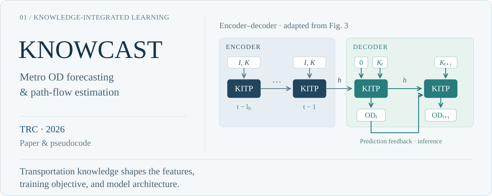
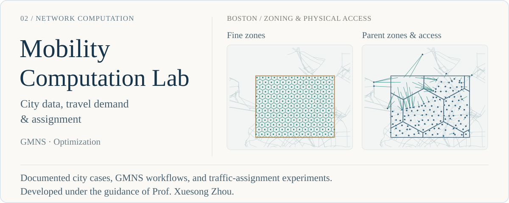
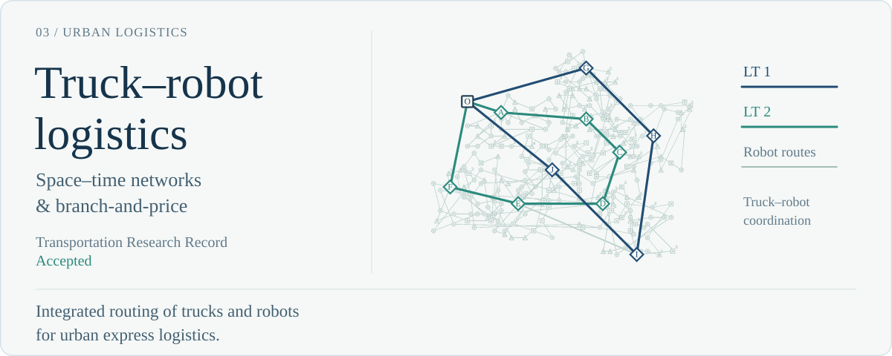
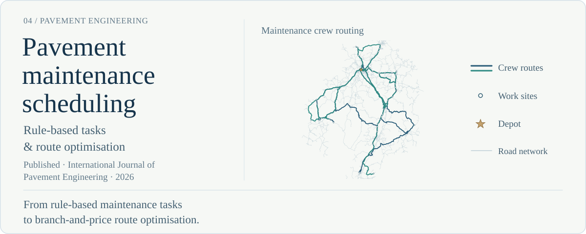
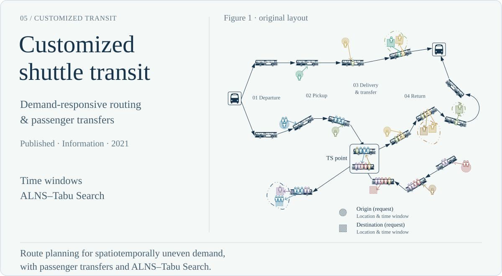

<a href="https://scholarhaozheng.github.io/">
<picture>
  <source media="(max-width: 640px)" srcset="assets/v4/hero-mobile.svg">
  
</picture>
</a>

 &nbsp; &nbsp;  &nbsp; &nbsp;  &nbsp; &nbsp;  &nbsp; &nbsp; 

<picture>
  <source media="(max-width: 640px)" srcset="assets/v4/intro-mobile.svg">
  
</picture>

<picture>
  <source media="(max-width: 640px)" srcset="assets/v4/selected-work-mobile.svg">
  
</picture>

<a href="assets/projects/knowcast-architecture.png">
<picture>
  <source media="(max-width: 640px)" srcset="assets/v4/knowcast-mobile.svg">
  
</picture>
</a>

 &nbsp; &nbsp;  &nbsp; &nbsp;  &nbsp; &nbsp; 

 

<a href="assets/projects/mobility-boston.png">
<picture>
  <source media="(max-width: 640px)" srcset="assets/v4/mobility-mobile.svg">
  
</picture>
</a>

 &nbsp; &nbsp;  &nbsp; &nbsp;  &nbsp; &nbsp; 

 

<a href="assets/projects/truck-robot-logistics.png">
<picture>
  <source media="(max-width: 640px)" srcset="assets/v4/truck-mobile.svg">
  
</picture>
</a>

 &nbsp; &nbsp; 

 

<a href="https://doi.org/10.1080/10298436.2026.2708283">
<picture>
  <source media="(max-width: 640px)" srcset="assets/v4/pavement-mobile.svg">
  
</picture>
</a>

 &nbsp; &nbsp; 

 

<a href="https://doi.org/10.3390/info12100429">
<picture>
  <source media="(max-width: 640px)" srcset="assets/v4/shuttle-mobile.svg">
  
</picture>
</a>

 &nbsp; &nbsp; 

 

 &nbsp; &nbsp; 

