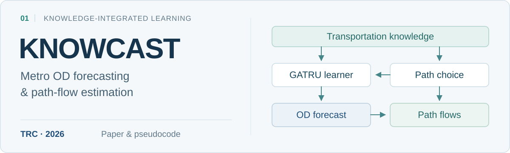
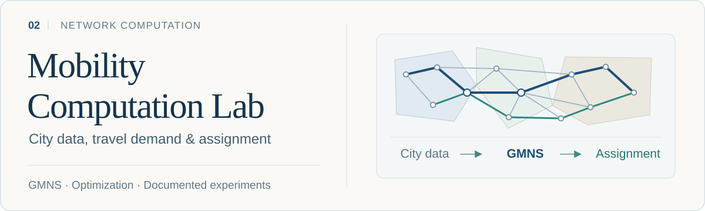

<a href="https://scholarhaozheng.github.io/">
  <picture>
    <source media="(max-width: 640px)" srcset="assets/v2/hero-mobile.svg">
    
  </picture>
</a>

  <a href="https://scholarhaozheng.github.io/"><strong>Website</strong></a>
  &nbsp; / &nbsp;
  <a href="https://scholar.google.com/citations?user=5XSrtxwAAAAJ">Scholar</a>
  &nbsp; / &nbsp;
  <a href="https://orcid.org/0009-0004-8845-5137">ORCID</a>
  &nbsp; / &nbsp;
  <a href="https://scholarhaozheng.github.io/CV_of_Hao_Zheng.pdf">CV</a>
  &nbsp; / &nbsp;
  <a href="mailto:scholarhaozheng@gmail.com">Email</a>

I develop computational methods for **transportation systems**, connecting mobility data, transportation knowledge, and network optimization to support prediction and decision-making.

M.S. in Transportation Engineering, **Tsinghua University** · Research Assistant, **Beijing Jiaotong University**.

## Selected work

<a href="https://scholarhaozheng.github.io/KNOWCAST/">
  <picture>
    <source media="(max-width: 640px)" srcset="assets/v2/knowcast-mobile.svg">
    
  </picture>
</a>

**Transportation knowledge inside the learning process.** KNOWCAST brings trip generation, trip distribution, and route choice into a coupled forecasting framework. Explore the paper, figures, and structured pseudocode companion.

**[Project website ↗](https://scholarhaozheng.github.io/KNOWCAST/)** &nbsp; · &nbsp; [Paper](https://doi.org/10.1016/j.trc.2026.105710) &nbsp; · &nbsp; [Repository](https://github.com/scholarhaozheng/KNOWCAST) &nbsp; · &nbsp; [Pseudocode guide](https://github.com/scholarhaozheng/KNOWCAST/blob/main/PSEUDOCODE_GUIDE.md)

 

<a href="https://scholarhaozheng.github.io/mobility-network-lab/">
  <picture>
    <source media="(max-width: 640px)" srcset="assets/v2/mobility-mobile.svg">
    
  </picture>
</a>

**From city data to network computation.** Mobility Computation Lab connects documented city cases, GMNS workflows, and traffic-assignment experiments. Developed under the guidance of **Prof. Xuesong Zhou**.

**[Explore the lab ↗](https://scholarhaozheng.github.io/mobility-network-lab/)** &nbsp; · &nbsp; [Interactive demo](https://scholarhaozheng.github.io/mobility-network-lab/traffic-assignment-lab.html) &nbsp; · &nbsp; [Experiments](https://scholarhaozheng.github.io/mobility-network-lab/reproduce.html) &nbsp; · &nbsp; [Repository](https://github.com/scholarhaozheng/mobility-network-lab)

## More research

<strong><a href="https://github.com/scholarhaozheng/Software-Package-for-Hybrid-Route-Planning-of-Same-Day-and-Regular-Deliveries-in-Space-Time-Networks">Truck–robot logistics</a></strong> Space–time networks and branch-and-price for urban express logistics. Transportation Research Record · Accepted

<strong><a href="https://doi.org/10.1080/10298436.2026.2708283">Pavement maintenance scheduling</a></strong> Connecting maintenance task generation with vehicle-route optimization. International Journal of Pavement Engineering · 2026 &nbsp; / &nbsp; <a href="https://github.com/scholarhaozheng/Decision_Making_for_Pavement_Maintenance_Strategies_and_a_VRP_Model_for_Execution">Repository</a>

<strong><a href="https://doi.org/10.3390/info12100429">Customized shuttle transit</a></strong> Route planning for demand that varies across space and time. Information · 2021 &nbsp; / &nbsp; <a href="https://github.com/scholarhaozheng/A-Multi-Type-Customized-Shuttle-Bus-Route-Planning-Software">Repository</a>

---

**[Full publication list](https://scholarhaozheng.github.io/#publications)** &nbsp; · &nbsp; [Research & experience](https://scholarhaozheng.github.io/#research)
